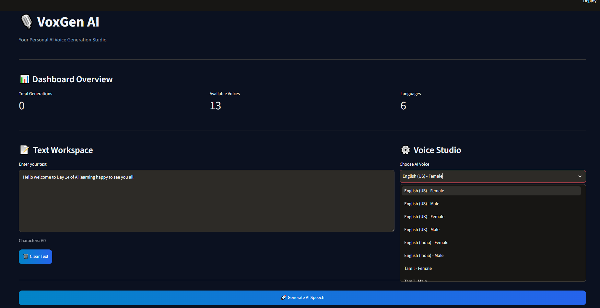
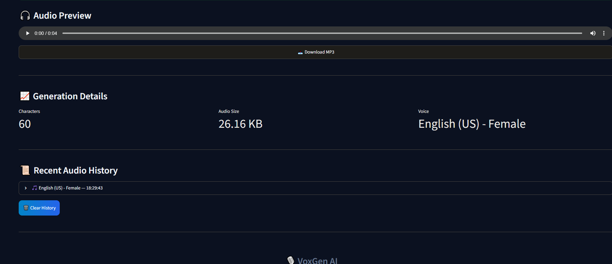
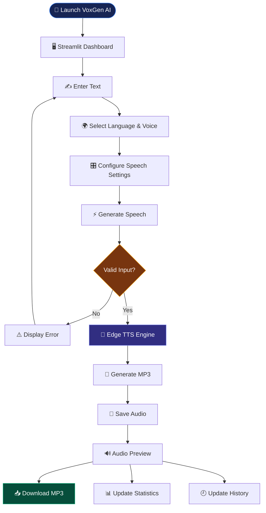

<div align="center">

# 🎙️ VoxGen AI

### AI-Powered Multilingual Text-to-Speech Studio

**Transform your words into natural-sounding speech with AI.**

<p>
  
  
  
  
</p>

</div>

---

## 🌟 Overview

**VoxGen AI** is a modern multilingual Text-to-Speech application built using Python, Streamlit and Microsoft Edge TTS.

It transforms written text into natural-sounding speech using neural AI voices. Users can select languages, customize voice settings, listen to generated audio and download it in MP3 format.

With an interactive dashboard and customizable speech controls, VoxGen AI makes voice generation simple and accessible.

---

## ✨ Features

| Feature | Description |
|---|---|
| 🌍 Multilingual Support | Generate speech in multiple languages |
| 🎙️ Neural AI Voices | Choose from different AI voices |
| ⚡ Text-to-Speech | Convert written text into audio |
| 🎛️ Voice Customization | Adjust speed, volume and pitch |
| 🔊 Audio Preview | Listen to generated speech |
| 📥 MP3 Download | Download generated audio |
| 📊 Dashboard Analytics | Track generation statistics |
| 🕘 Audio History | Access recent generations |
| 🧹 Text Management | Clear text and generation history |
| 🎨 Modern UI | Interactive Streamlit dashboard |

---

## 🖥️ Application Preview

### 🎛️ Main Dashboard

<p align="center">
  
</p>

### 🔊 Audio Preview

<p align="center">
  
</p>

---

## 🌍 Supported Languages

VoxGen AI includes neural voice options for:

- 🇺🇸 English (United States)
- 🇬🇧 English (United Kingdom)
- 🇮🇳 English (India)
- 🇮🇳 Tamil
- 🇮🇳 Hindi
- 🇫🇷 French
- 🇩🇪 German
- 🇪🇸 Spanish

*Available voices depend on the configured voice list.*

---

## 🛠️ Technology Stack

| Technology | Purpose |
|---|---|
| Python | Core programming language |
| Streamlit | Interactive web interface |
| Edge TTS | Neural Text-to-Speech engine |
| asyncio | Asynchronous processing |
| MP3 | Generated audio format |

---

## ⚙️ Installation & Setup

### 1. Clone the Repository

```bash
git clone https://github.com/21vicky/VoxGen-AI.git
```

### 2. Navigate to Project Folder

```bash
cd VoxGen-AI
```

### 3. Create Virtual Environment

```bash
python -m venv venv
```

### 4. Activate Environment

**Windows:**

```bash
venv\Scripts\activate
```

### 5. Install Dependencies

```bash
pip install -r requirements.txt
```

### 6. Run Application

```bash
streamlit run app.py
```

The application will open in your default browser.

---

## 🔄 Project Workflow



📖 **Detailed documentation:** [WORKFLOW.md](WORKFLOW.md)

---

## 📁 Project Structure

```text
VoxGen-AI/
│
├── app.py
├── requirements.txt
├── README.md
├── WORKFLOW.md
├── .gitignore
│
├── assets/
│   ├── voxgen-dashboard.png
│   └── voxgen-audio-preview.png
│
└── generated_audio/
    └── Generated MP3 files
```

---

## 🧠 What I Learned

Through this project, I explored:

- Implementing Text-to-Speech using neural AI voices.
- Working with the Edge TTS Python library.
- Building interactive applications using Streamlit.
- Managing asynchronous Python operations.
- Customizing speech speed, volume and pitch.
- Generating and downloading MP3 audio.
- Managing application state using Streamlit session state.
- Designing a modern AI-powered dashboard.

---

## 🔮 Future Enhancements

- Persistent audio generation history.
- Batch text-to-speech conversion.
- Additional neural voice options.
- Voice preview before generation.
- Cloud deployment.

---

## ⚠️ Important Notes

- An active internet connection is required for Edge TTS speech generation.
- Generated MP3 files are saved locally.
- Recent history and generation statistics use Streamlit session state and may reset when the session restarts.

---

## 👨‍💻 Developer

<div align="center">

### Vignesh U

**Aspiring AI & ML Engineer | Full Stack Developer**

Building practical AI applications and exploring the future of Artificial Intelligence.

<p>
  <a href="https://github.com/21vicky">
    
  </a>
</p>

</div>

---

<div align="center">

### 🎙️ VoxGen AI

**Give Your Words a Voice.**

*Built with ❤️ using Python and Artificial Intelligence.*

</div>