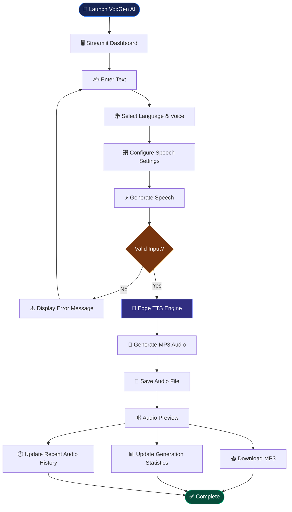

# 🎙️ VoxGen AI — System Workflow

  <b>From Text to Natural-Sounding Speech</b> 
  An AI-powered multilingual Text-to-Speech application.

---

## ⚡ Application Architecture

---

## 🔄 How VoxGen AI Works

| Step | Process | Description |
|---|---|---|
| 01 | User Input | Enter text in the workspace |
| 02 | Voice Selection | Choose language and AI voice |
| 03 | Speech Controls | Adjust speed, volume and pitch |
| 04 | Processing | Edge TTS processes the text |
| 05 | Audio Generation | Generate speech in MP3 format |
| 06 | Audio Preview | Listen to generated speech |
| 07 | Download | Download the MP3 file |
| 08 | History | Track recent generations |

---

## 🧠 Technology Stack

| Technology | Purpose |
|---|---|
| Python | Core programming language |
| Streamlit | Interactive web interface |
| Edge TTS | Neural text-to-speech engine |
| asyncio | Asynchronous speech generation |
| MP3 | Generated audio format |

---

## 🎛️ Core Modules

- **Text Workspace:** Accepts user text.
- **Voice Studio:** Manages language and voice selection.
- **Speech Controls:** Adjusts speed, volume and pitch.
- **Audio Engine:** Generates speech through Edge TTS.
- **Audio Player:** Plays generated speech.
- **Download Manager:** Downloads generated MP3 files.
- **History Manager:** Maintains recent generation history.
- **Dashboard:** Displays usage statistics.

---

## 🔐 Data & Processing

- Text is processed through the Edge TTS online service.
- Generated MP3 files are saved locally.
- Recent history and generation statistics are maintained using Streamlit session state.
- The application requires an internet connection for speech generation.

---

## 🚀 Future Enhancements

- Audio generation history persistence
- Downloadable audio history
- More language and voice options
- Batch text-to-speech conversion
- Voice preview functionality

---

  <b>🎙️ VoxGen AI</b> 
  Transform Words into Voice with AI.

